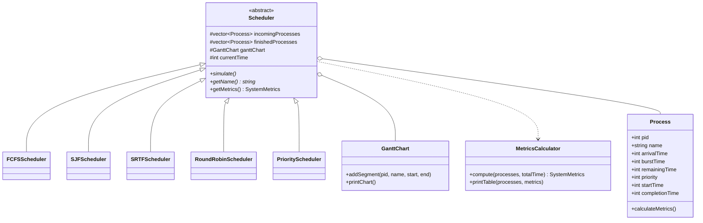

# CPU Process Scheduling & Dispatcher Simulator

[](https://github.com/GodsGreatness/cpu-process-scheduler/actions/workflows/ci.yml)
[](https://en.wikipedia.org/wiki/C%2B%2B17)
[](LICENSE)
[]()

A high-performance, modular operating systems scheduling engine written in modern **C++17**. The simulator models real-world CPU dispatching policies, visualizes execution timelines via terminal **ASCII Gantt Charts**, generates detailed per-process and system-level performance metrics, and features a multi-algorithm comparative benchmark leaderboard.

---

## ⚡ Core Features

- **5 Fundamental Scheduling Policies:**
  - **FCFS** (First-Come, First-Served)
  - **SJF** (Shortest Job First - Non-Preemptive)
  - **SRTF** (Shortest Remaining Time First - Preemptive)
  - **Round Robin (RR)** with configurable time quantum
  - **Priority Scheduling** supporting both Preemptive/Non-Preemptive modes and **Dynamic Aging** to mitigate starvation.
- **ASCII Gantt Chart Timeline:** Real-time visual timeline generator showing exact slice bounds, preemption events, and CPU idle intervals.
- **Comprehensive Performance Metrics:**
  - Turnaround Time ($TAT = CT - AT$)
  - Waiting Time ($WT = TAT - BT$)
  - Response Time ($RT = ST - AT$)
  - CPU Utilization percentage and system throughput.
- **Multi-Algorithm Benchmark Mode (`--compare`):** Executes all scheduling algorithms concurrently against the same workload and prints a comparative performance leaderboard.
- **Cross-Platform & Zero External Dependencies:** Compiles natively using GCC, Clang, or MSVC with either `make` or `cmake`.
- **Test-Driven Architecture:** Includes a dedicated unit test suite validating edge cases (simultaneous arrivals, zero remaining time, preemption boundaries, aging boosts, and idle gaps).

---

## 🏛️ Architecture Overview



---

## 🚀 Quickstart

### Prerequisites
* A C++17 compliant compiler (`g++`, `clang++`, or `MSVC`)
* GNU Make or CMake (>= 3.15)

### Build Instructions

#### Using Make:
```bash
# Build both main simulator and test runner
make all

# Run unit tests
make test
```

#### Using CMake:
```bash
cmake -B build -DCMAKE_BUILD_TYPE=Release
cmake --build build --config Release
ctest --test-dir build --output-on-failure
```

---

## 💻 Usage & CLI Options

```bash
# Run multi-algorithm comparative benchmark on a workload
./bin/cpu_scheduler --file workloads/heavy_concurrency.txt --compare

# Simulate Shortest Remaining Time First (SRTF)
./bin/cpu_scheduler --file workloads/basic.txt --algorithm srtf

# Simulate Round Robin with custom time quantum (q = 4)
./bin/cpu_scheduler --file workloads/basic.txt --algorithm rr --quantum 4

# Simulate Preemptive Priority with Dynamic Aging (interval = 3 units)
./bin/cpu_scheduler --file workloads/basic.txt --algorithm priority --preemptive --aging
```

### CLI Arguments Reference

| Flag | Argument | Description | Default |
| :--- | :--- | :--- | :--- |
| `--file` | `<path>` | Path to custom workload file (`PID Name Arrival Burst [Priority]`) | Default test set |
| `--algorithm` | `fcfs \| sjf \| srtf \| rr \| priority` | Select specific policy | `compare` |
| `--quantum` | `<int>` | Time quantum for Round Robin | `2` |
| `--preemptive` | *(none)* | Enable preemption for priority scheduling | Disabled |
| `--aging` | *(none)* | Enable starvation prevention via dynamic priority aging | Disabled |
| `--compare` | *(none)* | Run all policies concurrently and display leaderboard | Active |

---

## 📊 Sample Execution & Outputs

### 1. ASCII Gantt Chart Timeline (SRTF Example)
```text
=== Gantt Chart Execution Timeline ===

+------+------------+---------------+---------------------+---------------------------+
|  P1  |     P2     |      P4       |         P1          |            P3             |
+------+------------+---------------+---------------------+---------------------------+
0      1            5              10                    17                          26
```

### 2. Multi-Algorithm Benchmark Leaderboard
Workload: `workloads/heavy_concurrency.txt` (6 concurrent processes)

```text
+-----------------------------------------------------+---------------+---------------+---------------+-------------+
| Algorithm                                           | Avg Turnaround| Avg Waiting   | Avg Response  | CPU Util %  |
+-----------------------------------------------------+---------------+---------------+---------------+-------------+
| First-Come, First-Served (FCFS)                     |         30.33 |         21.67 |         21.67 |     100.00% |
| Shortest Job First (SJF - Non-Preemptive)           |         22.33 |         13.67 |         13.67 |     100.00% |
| Shortest Remaining Time First (SRTF - Preemptive)   |         18.67 |         10.00 |          6.67 |     100.00% |
| Round Robin (RR, Quantum = 2)                       |         28.33 |         19.67 |          4.00 |     100.00% |
| Non-Preemptive Priority                             |         22.67 |         14.00 |         14.00 |     100.00% |
| Preemptive Priority (with Aging interval 4)         |         26.33 |         17.67 |          7.17 |     100.00% |
+-----------------------------------------------------+---------------+---------------+---------------+-------------+
```

---

## 🧪 Automated Testing

The simulator includes a self-contained unit test suite verifying scheduling correctness across:
* **Sequential & Disordered Arrivals:** Validates correct queue ordering.
* **Preemption Triggers:** Ensures newly arrived shorter tasks immediately suspend running tasks.
* **Round Robin Time Slicing:** Verifies queue re-ordering upon slice exhaustion.
* **Starvation & Aging:** Verifies priority promotion under sustained contention.
* **CPU Idle Intervals:** Checks correct handling when no processes are ready.

Run tests anytime with:
```bash
./bin/run_tests
```

---

## 📁 Repository Structure

```text
cpu-process-scheduler/
├── .github/
│   └── workflows/
│       └── ci.yml               # Automated GitHub Actions CI matrix
├── docs/
│   └── algorithms.md            # Mathematical formulations and theoretical trade-offs
├── include/                     # C++ Header files
│   ├── Process.hpp              # Process Control Block (PCB) definitions
│   ├── GanttChart.hpp           # ASCII timeline renderer
│   ├── Metrics.hpp              # Performance stats & table output
│   ├── Scheduler.hpp            # Base scheduler interface
│   ├── FCFS.hpp
│   ├── SJF.hpp
│   ├── SRTF.hpp
│   ├── RoundRobin.hpp
│   └── PriorityScheduler.hpp
├── src/                         # Implementation source files
│   ├── Process.cpp
│   ├── GanttChart.cpp
│   ├── Metrics.cpp
│   ├── FCFS.cpp
│   ├── SJF.cpp
│   ├── SRTF.cpp
│   ├── RoundRobin.cpp
│   ├── PriorityScheduler.cpp
│   └── main.cpp                 # CLI driver & benchmark engine
├── tests/
│   └── test_scheduler.cpp       # Unit test suite
├── workloads/                   # Sample simulation datasets
│   ├── basic.txt
│   ├── preemption_test.txt
│   └── heavy_concurrency.txt
├── .gitignore
├── Makefile
├── CMakeLists.txt
├── LICENSE
└── README.md
```

---

## 📄 License
This project is open-source under the [MIT License](LICENSE).
